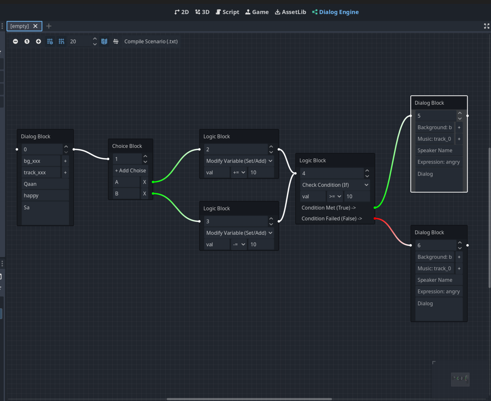
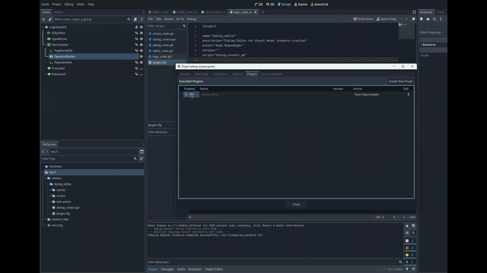
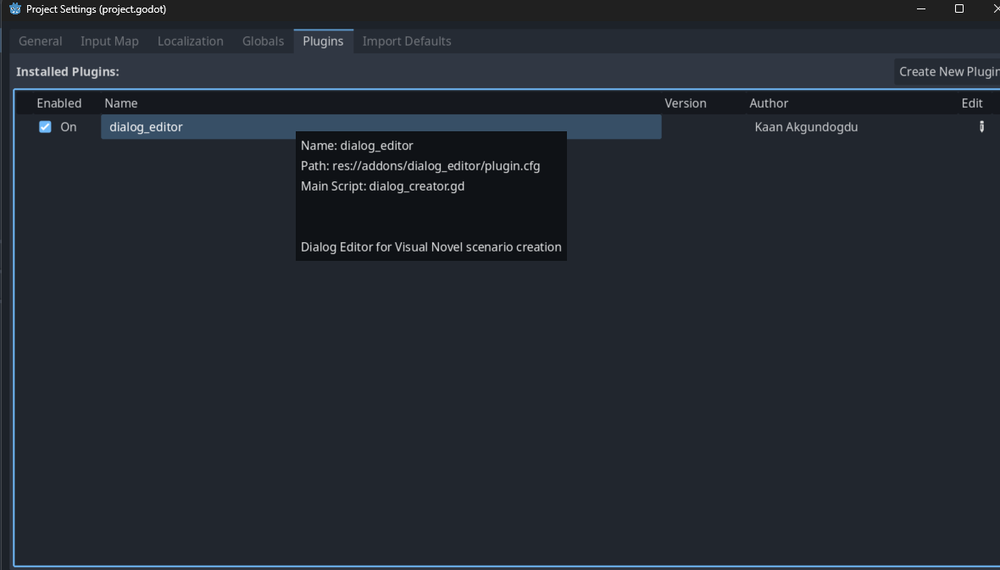

+++
title = "Devlog #2: Custom Dialog System And New Custom Plugin"
date = 2026-07-20
description = "Why I stopped using JSON for my Godot visual novel and how I built a custom visual dialog editor plugin directly inside Godot."
aliases = ["/blog/VisualNovelGodot/devlog2.html"]

[taxonomies]
tags = ["godot", "gamedev", "visual-novel"]

[extra]
lang = "en"
+++
Hi, and welcome to my making Visual Novel with Godot journey.

In this post, I will explain why I stopped using JSON, why I built my own visual tool, and how I created a custom dialog editor directly inside Godot.

Here is an example of dialog editor plugin:



## Why I Stopped Using JSON

In my first post, I explained how I built my dialog system using JSON. It was a good starting point, and it worked well for simple conversations.

However, as I started writing more complex branching stories, I realized I needed a better solution.

My main problems with Json was these:

* Writing keys like "speaker":, "dialog":, and "next_id": manually for every single line of text is very slow.
* Seeing the flow of the story is almost impossible.

I realized that if I wanted to make a full visual novel, I needed to see my story visually, like a flowchart.

Instead of using external software, I decided to build my own node based editor directly inside the Godot Engine. This way, I could easily drag and drop my game assets and write my story in the same program where I make my game.

Also in the future if I decided to writing story is not my type of thing, maybe I will ask someone else write for me.
And I wanted them to work in better environment maybe they are not techinal person and they don't want to write some random scripts.
With this new tool and much simpler dialog system I hope anyone can understand and be able to use it.

My goal is this: create a new format for story, and make a visual tool to write the story, and let the tool generate a clean, easy to read text file for my game code to read.
## Creating New Story Parser

The new story parser reads the text file line by line and understands what to do based on the first character of the line. New textbased parser is much easier to manage and debug. 

Here is how the new syntax works:

* '#' for Nodes: If a line begins with # id: the parser creates a new, separate dialog block.
* ':' for Dialogue & Acting: The parser looks for a colon (:) to identify dialogue. The text before the colon becomes the speaker's name, and the text after it becomes the dialogue (e.g., Narrator: It was raining). I also added a clean way to extract character expressions and animations in the same line using brackets: Taiga (angry) [shake]: What are you doing?!
* '-' for Choices: Lines starting with - automatically create interactive buttons for the player and link to a target ID (for example: - Apologize to her -> 20).
* '@' for Commands & Logic: Lines starting with @ control the game's environment and story flow.

	* Visuals & Audio: I use commands like @bg to change the background, @music to play audio, and @leave to clear a character from the screen.
	* Story Flow: The @jump command easily redirects the story to another node.
	* Multi-Instance Logic: Thanks to a new array-based logic in the code, I can now stack multiple @set_var (to change variables) and @jump_if (to check conditions) commands inside the very same node without them overwriting each other.

Of course this is current supported features in the future this can be change. Now I am good with this but maybe in the future I may encounter some new problems.
### The Logic System

My StoryState class now tracks variables and handles mathematical operators.

* We can easily change variables using @set_var. For example, @set_var affection += 10 adds points, or @set_var teased_taiga = true saves a true/false flag
* We can create smart, conditional story paths using @jump_if. For example, if I write @jump_if affection >= 15 50, the game checks the math and automatically jumps to node 50 if the player's affection score is high enough.

I also updated the parser so it can process multiple commands in the same block without overwriting each other. Now, we can give a player points, play a sound effect, and check a condition all in a single step!

Here is simple scenario file I am using right now:
```
# id: 0
@bg FuyukiBridge/pedestrian_overpass_going_day
@music background_nujabes_aur
@set_var teased_taiga = false
@set_var taiga_affection = 0
Narrator: It was a peaceful afternoon. The sun was slowly setting over the city.

# id: 1
Taiga (casual_handscross_normal_mid): Oh, it's [b]you[/b]. I didn't expect to see you here.

# id: 2
Taiga (casual_handsfront_angry_mid): And why are you staring at me like that? Do I have something on my face?!

# id: 3
- Sorry, I just zoned out for a second. -> 4
- I was just admiring your... [i]unique[/i] fashion sense. -> 6
- I bought you a snack from the convenience store! -> 9

# id: 4
@sfx magic_sweep_game_trophy
Taiga (casual_shocked_far): Wh-what? You zoned out?

# id: 5
@set_var taiga_affection -= 5
Taiga (casual_handscross_normal_mid): [color=gray]*sigh*[/color] You are always so spacey. Try to pay more attention to your surroundings!
@jump 12

# id: 6
@set_var teased_taiga = true
@set_var taiga_affection += 5
Taiga (casual_angry_close): [color=red]EXCUSE ME?![/color] What exactly is wrong with my clothes?!

# id: 7
Taiga (casual_handsfront_angry_mid): You have exactly [b]three seconds[/b] to run before I kick you!
@jump 12

# id: 8
@jump 12

# id: 9
@set_var taiga_affection += 20
Taiga (casual_shocked_far): Wait, really? For me? 

# id: 10
@sfx magic_sweep_game_trophy
Taiga (casual_handscross_normal_mid): I... I suppose you can be somewhat thoughtful sometimes. 

# id: 11
Taiga: Don't expect me to thank you profusely, though!
@jump 12

# id: 12
@leave taiga
@bg FuyukiBridge/riverbank_view_bridge_day
Narrator: We walked together towards the riverbank. The atmosphere was certainly something.
```

This simple and clean text file can control so much complex game logic.
## Custom Tool For New Parser

While developing the new story parser, I found the task of creating text files annoying, and I am also too lazzy to write texts.

I wanted to have a tool readily available whenever I wanted to make changes or work in a more user friendly environment.
I was aware that Godot had plugins and I also wanted to write my own editor tool. I started writing a new tool and creating text files with it.

**You can see the current version of the new tool below:**



Godot is an incredible engine because the editor itself is made with Godot's UI nodes. This means you can use the same nodes you use for your games to build custom tools. 

You can visit this page to learn more about it: <a href="https://docs.godotengine.org/en/stable/tutorials/plugins/editor/making_plugins.html" target="_blank" rel="noopener noreferrer">Making plugins</a>

The beautiful thing about it is you don't need to run scene to make plugin work. You can use tools inside editor itself.

Here are the main features I used:

* @tool Script and EditorPlugin: By using the @tool keyword, I told Godot to run my code inside the editor, not just when the game is playing. I created an EditorPlugin so my dialog system shows up as a brand new tab right next to the "2D", "3D", and "Script" workspaces.
* GraphEdit and GraphNode: Godot has built-in nodes for creating node based interfaces. I used GraphEdit to create the infinite, zoomable background grid. And I used GraphNode to design the draggable boxes (like Dialog Blocks, Choice Blocks, and Logic Blocks).
* File Dialogs: I added buttons that open file browsers, so I can easily select my .png backgrounds and .mp3 tracks without typing long file paths.


Now, instead of writing txt files or JSON, I just right click on the grid, add a node, type my text, and connect them with lines.
### Visual to Text

The most important part of this new tool is the Compiler. When I finish connecting my nodes, I click a "Compile Scenario (.txt)" button. The tool reads all the connected nodes from left to right, follows the lines, and generates a simple .txt file. 

Of course it still needs further improvements but I am satisfied with the current version right now.

I also want to mention some small issues with UI nodes and plugin.

* The main thing is whenever I made changes in the plugin I had to disable and then enable the plugin to make the some changes be available.

* Also I think this is issue about godot engine but I am not 100% sure: when I create a new txt scenario the file in the cache stays. I used cat command to see file is changed but when I check in the scripts section in the godot the text stays same. It is little bit annoying to fix this I delete sceanio txt file and compile again to see new version of file in the Godot.

You can go project settings/plugins section to enable disable plugin:


## Current Version of Development

Here is the final version of the game. You can see it in the GIF below.


I hope you enjoyed and found this article informative. See you in the next devlog!

Here are my links if you want to connect or follow:

>- <a href="https://github.com/kaanakgundogdu" target="_blank">Github</a>
>- <a href="https://www.linkedin.com/in/kaanakgundogdu/" target="_blank">LinkedIn</a>